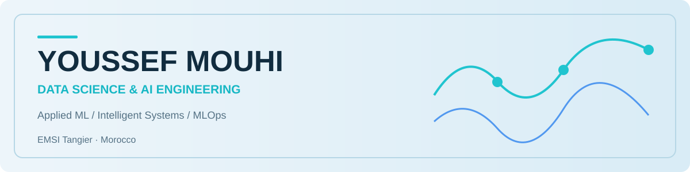

<picture>
  <source media="(prefers-color-scheme: dark)" srcset="assets/profile-header-dark.svg">
  
</picture>

### Data Science & AI Engineering · Applied ML · MLOps

I'm **Youssef Mouhi**, a Computer & Network Engineering student specializing in **Data Science and Artificial Intelligence** at **EMSI Tangier, Morocco**. I build practical machine-learning systems that connect data preparation, model evaluation, explainability, deployment, and usable interfaces.

My work spans predictive analytics, fraud detection, forecasting, retrieval-augmented generation, and ML operations. I'm especially interested in **building reliable AI products**, not only training models.

## Selected engineering work

| Project | Area | What I built |
|:--|:--|:--|
| **[MLflowOps](https://github.com/YoussefMouhi/MLflowOps)** | Predictive maintenance · MLOps | XGBoost, MLflow registry, FastAPI, Streamlit, Docker, Prometheus metrics, Pytest, GitHub Actions CI |
| **[DocMind AI](https://github.com/YoussefMouhi/DocMind-AI)** | Document intelligence · RAG | Document ingestion, FAISS retrieval, local Qwen model, citations and retrieval evaluation |
| **[FraudShield AI](https://github.com/YoussefMouhi/FraudShield)** | Financial fraud detection | Imbalanced classification, anomaly detection, SHAP explanations and model comparisons |
| **[ForecastIQ](https://github.com/YoussefMouhi/ForecastIQ)** | Retail demand forecasting | XGBoost, statistical forecasting, LSTM architectures and interactive dashboards |
| **[Nexora AI](https://github.com/YoussefMouhi/Nexora-AI-Customer-Retention)** | Customer retention intelligence | Churn modeling, model validation, customer prioritization and Streamlit |

**[Browse my repositories →](https://github.com/YoussefMouhi?tab=repositories)**

## Focus & technical toolkit

**Machine learning** &nbsp; Python · scikit-learn · XGBoost · Feature engineering · Model evaluation  
**Deep learning & AI** &nbsp; PyTorch · NLP · RAG · Embeddings · SHAP  
**Data & visualization** &nbsp; Pandas · NumPy · Plotly · Streamlit  
**MLOps & engineering** &nbsp; MLflow · FastAPI · Docker · GitHub Actions · Pytest  
**Systems** &nbsp; REST APIs · SNMP monitoring · Data pipelines

## Experience & leadership

<strong>Internships, engineering education and organizational leadership</strong>

### Professional internships

**AI Transformation Engineering Intern — Atos, Casablanca · July–August 2026**  
Worked on an **AI-powered automated testing agent for Salesforce B2B Commerce**, combining large language models, Model Context Protocol (MCP), Playwright and Python. Developed agent-based testing and orchestration workflows for browser-based scenarios, with deployment and monitoring components. This was an internship project, not a production-wide deployment claim.

**IT Intern — Yazaki Morocco, Tangier · 2025**  
Worked with the IT department on infrastructure operations, workstation preparation and support. Developed **APMS (Access Points Management & Monitoring System)**, a web-based prototype for monitoring access points, collecting SNMP-based simulated telemetry, displaying health/performance dashboards and highlighting alerts. The final demonstration covered **47 simulated access points**, not 47 confirmed live devices.

### Leadership & community impact

**President — Lions Club Tangier EMSI · 2025–2026**  
Led a student volunteer organization, coordinating members, executive-board responsibilities, partnerships, event planning and humanitarian initiatives. A major undertaking was **Project Elysium**, a school-improvement initiative at **École Ghzielech, Melloussa**, involving renovations and educational activities supported by **Fondation Tanger Med**. Other activities included blood donation, community support and educational outreach.

**Communication & Marketing Responsible — Lions Club Tangier EMSI · 2024–2025**  
Contributed to the club's communication strategy, visual identity, social-media content and promotion of humanitarian projects and events.

**Founding Member — Lions Club Tangier EMSI**  
Participated in building the organization's early community and engagement activities before taking on communication and presidential responsibilities.

### Education

**Computer & Network Engineering — EMSI Tangier**  
Engineering specialization in **Data Science & Artificial Intelligence**, with academic work across machine learning, software engineering, data systems and networking.

## Engineering principles

I value **clear problem definitions**, reproducible experiments, transparent evaluation, and interfaces that make results understandable. My repositories aim to explain not just *what* a model predicts, but **how it was built, what was measured, and its limitations**.

---

