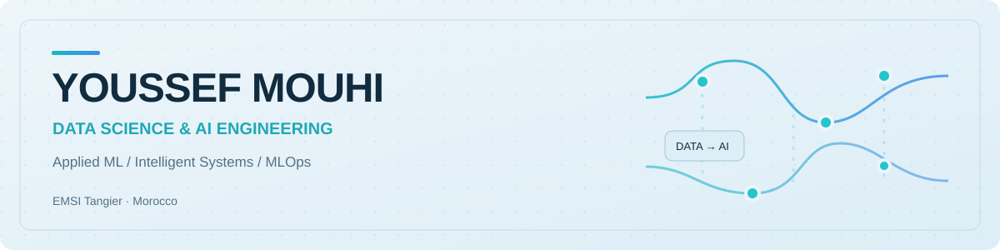

<picture>
  <source media="(prefers-color-scheme: dark)" srcset="assets/profile-header-dark.svg">
  
</picture>

### Data Science & AI Engineering · Applied ML · MLOps

I'm **Youssef Mouhi**, a Computer & Network Engineering student specializing in **Data Science and Artificial Intelligence** at **EMSI Tangier, Morocco**. I build practical machine-learning systems that connect data preparation, model evaluation, explainability, deployment, and usable interfaces.

My work spans predictive analytics, fraud detection, forecasting, retrieval-augmented generation, and ML operations. I'm especially interested in **building reliable AI products**, not only training models.

## Selected engineering work

| Project | Area | What I built |
|:--|:--|:--|
| **[MLflowOps](https://github.com/YoussefMouhi/MLflowOps)** | Predictive maintenance · MLOps | XGBoost, MLflow registry, FastAPI, Streamlit, Docker, Prometheus metrics, Pytest, GitHub Actions CI |
| **[DocMind AI](https://github.com/YoussefMouhi/DocMind-AI)** | Document intelligence · RAG | Document ingestion, FAISS retrieval, local Qwen model, citations and retrieval evaluation |
| **[FraudShield AI](https://github.com/YoussefMouhi/FraudShield)** | Financial fraud detection | Imbalanced classification, anomaly detection, SHAP explanations and model comparisons |
| **[ForecastIQ](https://github.com/YoussefMouhi/ForecastIQ)** | Retail demand forecasting | XGBoost, statistical forecasting, LSTM architectures and interactive dashboards |
| **[Nexora AI](https://github.com/YoussefMouhi/Nexora-AI-Customer-Retention)** | Customer retention intelligence | Churn modeling, model validation, customer prioritization and Streamlit |

**[Browse my repositories →](https://github.com/YoussefMouhi?tab=repositories)**

## Focus & technical toolkit

**Machine learning** &nbsp; Python · scikit-learn · XGBoost · Feature engineering · Model evaluation  
**Deep learning & AI** &nbsp; PyTorch · NLP · RAG · Embeddings · SHAP  
**Data & visualization** &nbsp; Pandas · NumPy · Plotly · Streamlit  
**MLOps & engineering** &nbsp; MLflow · FastAPI · Docker · GitHub Actions · Pytest  
**Systems** &nbsp; REST APIs · SNMP monitoring · Data pipelines

## Experience & leadership

<strong>Background, internship and organizational leadership</strong>

**IT Intern — Yazaki Morocco, Tangier**  
Developed **APMS (Access Points Management & Monitoring System)**, a prototype for centralized monitoring of wireless access points. Used SNMP simulation, data storage, dashboards and alerts, with a final demonstration covering 47 simulated access points.

**President — Lions Club Tangier EMSI (2025–2026)**  
Coordinated a student service organization, volunteers, events and humanitarian initiatives, combining leadership with planning, communication and partner coordination.

**Computer & Network Engineering — EMSI Tangier**  
Specialization in **Data Science & Artificial Intelligence**.

## Engineering principles

I value **clear problem definitions**, reproducible experiments, transparent evaluation, and interfaces that make results understandable. My repositories aim to explain not just *what* a model predicts, but **how it was built, what was measured, and its limitations**.

---

**Explore:** [All projects](https://github.com/YoussefMouhi?tab=repositories) · [MLflowOps](https://github.com/YoussefMouhi/MLflowOps) · [DocMind AI](https://github.com/YoussefMouhi/DocMind-AI)
